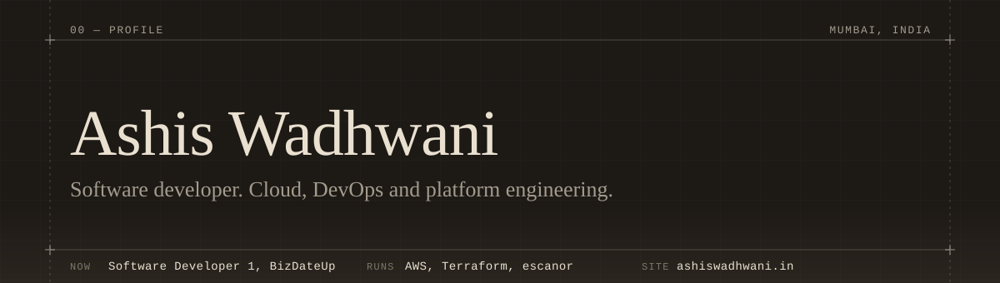
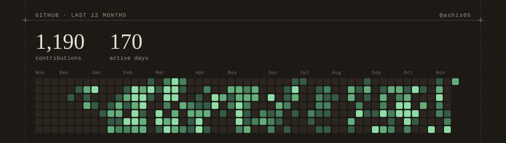
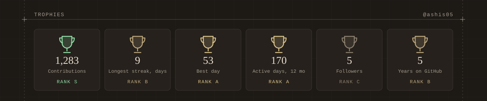

  

I'm a software developer at BizDateUp Technologies. I run the company's AWS and on-premise infrastructure, and I write the Python and TypeScript services that sit on top of it. Outside work I build my own projects and look after a small server at home called escanor.

## Details

- **Based in:** Mumbai, India. Open to on-site, hybrid or remote.
- **Role:** Software Developer 1, BizDateUp Technologies, since May 2026
- **Site:** [ashiswadhwani.in](https://www.ashiswadhwani.in)
- **Email:** [hello@ashiswadhwani.in](mailto:hello@ashiswadhwani.in)
- **LinkedIn:** [ashis-wadhwani-](https://www.linkedin.com/in/ashis-wadhwani-/)

## Tools and skills

**Cloud and infrastructure:** `AWS` `Terraform` `Docker` `Linux` `Cloudflare Tunnel` `Tailscale`

**CI/CD:** `GitHub Actions` `OIDC` keyless deploys

**Monitoring:** `Prometheus` `Grafana` `Loki` `Alertmanager`

**Languages:** `Python` `TypeScript` `JavaScript` `SQL` `Bash`, and some `Java`, `C`, `C++` and `C#`

**What I do:** infrastructure as code, least-privilege access, monitoring and alerting, backup restore drills, runbooks, backend services

## Things I've built

- **[Vulcan](https://www.ashiswadhwani.in/projects/vulcan)** is an AI fitness app that turns a photo of a meal into a calorie entry. It runs on AWS and I built it on my own.
- **[Text-to-CAD](https://www.ashiswadhwani.in/projects/text-to-cad)** has an LLM write CAD code instead of a mesh, so the part has exact dimensions, resizes with sliders and exports to STEP and STL.
- **[Manga Translator](https://github.com/ashis05/manga-translator-ai)** is a browser extension that translates manga on any page. The models run on my own GPU.

Each one has a write-up with the problem, the architecture and the trade-offs on [my site](https://www.ashiswadhwani.in/projects).

## GitHub

  

  

